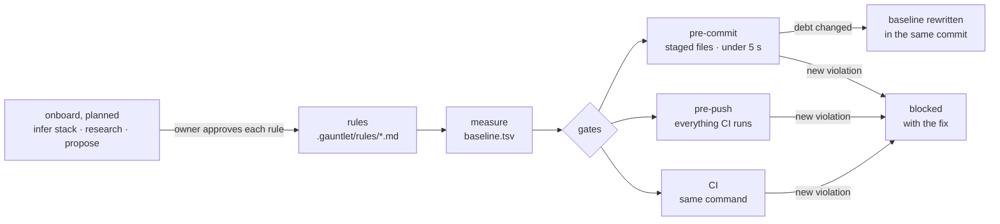
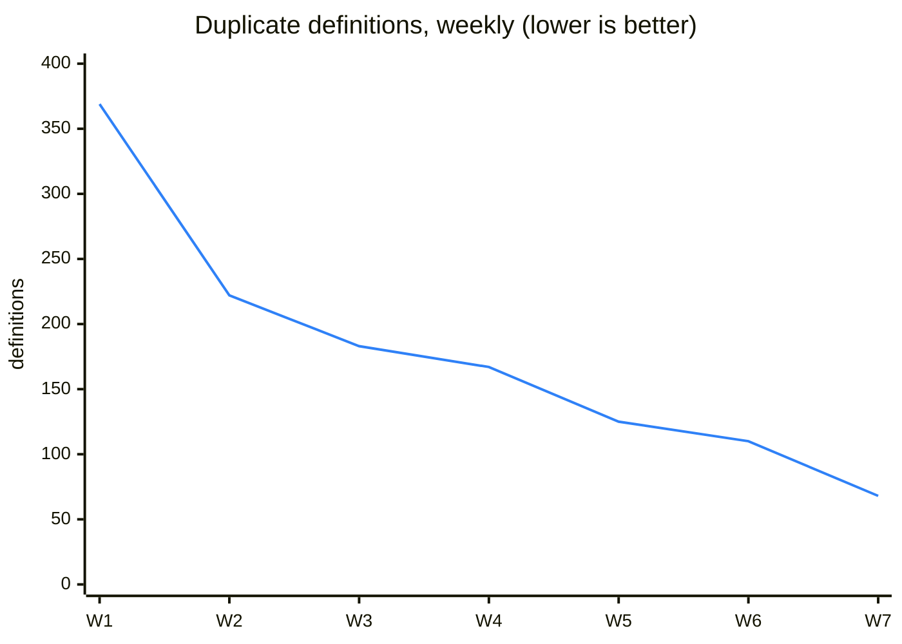

# gauntlet

**A code-quality ratchet for repositories where agents write the code.**

gauntlet studies your repository, agrees a set of rules with you, measures every existing violation, and from then on lets that number only go down. A new violation is caught when it is committed, when it is pushed, and in CI, whichever agent or human wrote it.

> **Status: runner usable by hand; skill in progress.** The runner works in this repo: `install`, `baseline`, `check`, `waive` and the rest, all in the [command reference](docs/guide/reference.md). The agent skill is not in yet, so onboarding is by hand. The specification is drafted: [vision, per-initiative PRD, FRDs and specs, and ADRs](docs/README.md). The process itself is not new: it ran by hand in a large production monorepo before it became gauntlet. See the [case study](docs/guide/case-study.md).

[Getting started](docs/guide/getting-started.md) · [Concepts](docs/guide/concepts.md) · [Rules & detectors](docs/guide/rules-and-detectors.md) · [Gates](docs/guide/gates.md) · [Exceptions](docs/guide/exceptions.md) · [Reference](docs/guide/reference.md) · [Agents](docs/guide/agents.md) · [Comparison](docs/guide/comparison.md) · [FAQ](docs/guide/faq.md)

---

## The problem

You write the rules down: `AGENTS.md`, an engineering-standards page, ADRs, review checklists. The agent reads them and agrees. Three PRs later the rules are broken again, every test is green, and nobody noticed. **A rule nobody counts is a suggestion.**

The usual fixes miss in two ways:

- **A fixed threshold** ("lint must be clean", "coverage ≥ 80 %") fails on day one in a real codebase. So it gets turned off, or set to whatever the code scores today, and it rots there.
- **A diff filter** ("only flag changed lines") forgets. Reformat a file and every old violation looks new. Move code, and new debt slips in looking old.

A **ratchet** does neither. It accepts today's debt as the floor and refuses to let the floor rise. gauntlet is a ratchet built for repositories where agents write most of the code:

- **It onboards itself** (planned). An agent will infer your stack, research each technology's own guidance, and propose rules one at a time for you to accept or reject. It never imposes a standard.
- **Every rule has a detector.** A rule that cannot be counted is not admitted. Detectors are declarative: a linter rule, an `ast-grep` rule or an `rg` pattern. No one writes a bespoke script "their own way".
- **Loosening fails the gate.** The baseline is derived: the runner writes it, and a hand edit that does not match the measurement fails CI. A loosened rule, or a loosened `.gauntlet/config`, fails `check --ci` unless an exception row exists for it. The runner cannot tell who wrote a row, and CI runs the runner the branch carries, so a branch that edits the runner is flagged for review, not stopped ([who CI trusts](docs/guide/gates.md#who-ci-trusts)). Keeping agents from writing rows is the job of the agent skill and the Claude Code adapter, both planned.
- **It coexists.** gauntlet adds one line to each shell hook you already have, placed first, and never takes them over.
- **It is agnostic** to language, agent harness and model. The runner is bash + awk + git.

## What it looks like

```console
$ git commit -m "feat: add invoice export"
gauntlet  commit · 1 rule · 0.1 s
[new]
  src/export/invoice.ts:42  todo  // TODO handle partial exports
      fix: Remove the TODO or ticket it.
[time]
  todo  50 ms
gauntlet: FAIL (1 problem)
```

```console
$ git commit -m "refactor: remove a TODO"
gauntlet  commit · 1 rule · 0.1 s
  todo  2 → 1   baseline updated and staged into this commit
[time]
  todo  59 ms
gauntlet: ok
```

## How it works



1. **Onboard** (planned). An agent skill will run once per repository, existing or empty, and propose each rule with its rationale, a primary source, the current count, the worst files, a detector and a fix hint, for you to accept, adjust or reject. Today you write the rule files yourself. Write new rules as **shadow** first: they report "would have failed" until you promote them. Nothing enforces this; only `block` rules fail the gate.
2. **Measure.** Every violation gets a **fingerprint** (rule + file + normalized line text), so inserting lines, moving code within a file and re-indenting change nothing. A formatter that rewrites the text of a flagged line, or a move to another file, makes it new.
3. **Gate.** In order of what is checked:
   - no new `block` fingerprint;
   - no rule total rises;
   - optionally, every touched file comes out lower than it went in;
   - the baseline equals what the code measures;
   - no rule was loosened.
4. **Tighten.** When a commit lowers the debt, the new baseline travels in that same commit, so nobody has to remember to commit it. A `shadow` or `track` rule, or a waived path, can also raise it there.

The [concepts page](docs/guide/concepts.md) explains each piece.

## Proven by hand first

Before gauntlet existed as a tool, its process ran by hand in a **large production monorepo** (mobile app, backend, shared packages; ~580 merged PRs over the period, largely written by AI agents). From each ratchet's first lock to 2026-10-16 (three to six weeks):

| Measured debt | Start | 2026-10-16 | Change |
|---|---:|---:|---:|
| Type-check errors | 40 | 6 | **−85 %** |
| Duplicate definitions | 369 | 68 | **−82 %** |
| Lint errors | 44 | 9 | **−80 %** |
| String literals compared instead of enums | 870 | 200 | **−77 %** |
| Silent `catch` blocks | 173 | 51 | **−71 %** |
| Exported functions without a return type | 265 | 91 | **−66 %** |
| React compiler rule violations | 113 | 58 | **−49 %** |
| Mobile ↔ backend boundary violations | 35 | 22 | **−37 %** |



Shipping did not slow down: merged PRs per week went *up* after the ratchets landed. The local gate stopped **71 of 519 pushes** (13.7 %) in its first logged week, before they reached CI.

**Disclaimer.** These numbers come from the origin project's git history, under the hand-built version of the process. gauntlet itself has not produced them yet. The [case study](docs/guide/case-study.md) covers the method, the caveats, where the hand-built version leaked, and how gauntlet's design answers each leak.

## Quick start

> The runner works by hand today. The agent skill and the v0.1 release are planned; follow the [changelog](CHANGELOG.md).

From a checkout of gauntlet that has `bin/gauntlet`, in your repo.

```sh
git clone --depth 1 https://github.com/antonygiomarxdev/gauntlet ~/.gauntlet
cd your-repo
~/.gauntlet/bin/gauntlet install     # copies the runner into .gauntlet/ and wires the hooks
```

Then write your rules in `.gauntlet/rules/` (the [getting started](docs/guide/getting-started.md) guide shows how), and run:

```sh
.gauntlet/bin/gauntlet baseline      # measure the existing debt, then commit .gauntlet/baseline.tsv
.gauntlet/bin/gauntlet status        # debt per rule, worst files, shadow rules due for promotion
.gauntlet/bin/gauntlet check --ci    # the gate CI runs
.gauntlet/bin/gauntlet doctor        # tools present, hooks wired, baseline exact
```

Onboarding by an agent (`ask your agent to onboard this repository`) is planned.

## Compared with

| | Rules from | Baseline | Language-agnostic | New-violation check | Touched-file check | Agent onboarding | Loosening guard |
|---|---|---|---|---|---|---|---|
| **gauntlet** | owner-approved | fingerprints, in repo | ✅ | ✅ fingerprint | ✅ | planned | exception row needed; a changed runner is flagged for review |
| [pawl](https://github.com/tiangong-dev/pawl) | any command | counts, in repo | ✅ | ✅ added lines | — | — | trailer + guard |
| [cleat](https://github.com/svetdev/cleat) | built-in gates | findings, in repo | ✅ | partial | — | partial | hook-enforced |
| [betterer](https://github.com/phenomnomnominal/betterer) | JS test files | results file | JS/TS | — | — | — | — |
| ESLint bulk suppressions | ESLint | suppressions file | JS/TS | — | — | — | — |
| [reviewdog](https://github.com/reviewdog/reviewdog) `-filter-mode=added` | any linter | none (diff only) | ✅ | ✅ added lines | — | — | — |
| [lefthook](https://github.com/evilmartians/lefthook) / [prek](https://github.com/j178/prek) | — (hook runners) | — | ✅ | — | — | — | — |

gauntlet runs inside lefthook, prek or husky rather than replacing them. The [full comparison](docs/guide/comparison.md) has the details.

## Scope

**In scope:** rules, detectors, baselines and gates for code quality, plus the agent skill that onboards and evolves them.

**Out of scope:**
- multi-agent orchestration;
- imposing an architecture or a standard;
- dashboards;
- package registries.

## Contributing

Start in [Discussions](https://github.com/antonygiomarxdev/gauntlet/discussions); maintainers open issues from confirmed discussions. Read [CONTRIBUTING.md](CONTRIBUTING.md) first. False positives have their own category, because a false positive is the fastest way to make people hate a gate.

## License

[MIT](LICENSE)
