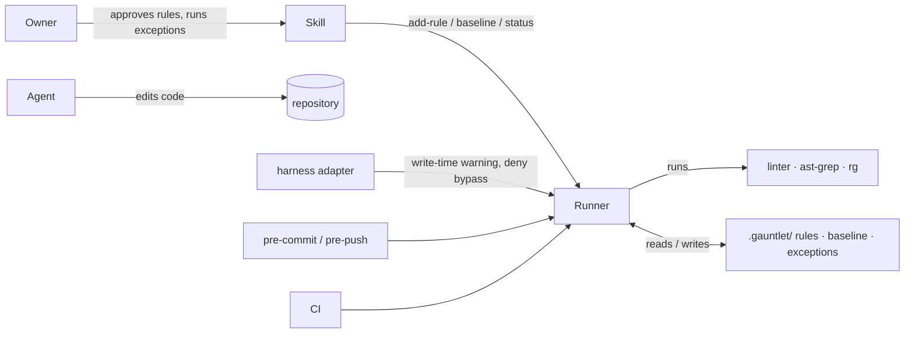

# Technical Proposal — gauntlet

**Status:** Draft
**Scope:** system. Every initiative builds on it; an initiative-local proposal names it as `Parent`.
**Parent:** [VISION](../VISION.md)
**PRD:** [I-01 Core](../initiatives/I-01-core/PRD.md)
**FRDs covered:** [FRD-01](../initiatives/I-01-core/frd/FRD-01-onboarding.md) · [FRD-02](../initiatives/I-01-core/frd/FRD-02-rules-and-detectors.md) · [FRD-03](../initiatives/I-01-core/frd/FRD-03-push-and-ci-gate.md) · [FRD-04](../initiatives/I-01-core/frd/FRD-04-exceptions.md) · [FRD-05](../initiatives/I-01-core/frd/FRD-05-agent-integration.md) · [FRD-06](../initiatives/I-01-core/frd/FRD-06-rule-lifecycle.md) · [FRD-07](../initiatives/I-01-core/frd/FRD-07-commit-gate-and-hooks.md)
**ADRs applied:** [0001](../adr/0001-runner-is-bash-awk-git.md)–[0011](../adr/0011-changelog-fragments-with-changie.md)

## 1. Engineering problem

One tool has to:
- measure owner-approved rules in any language;
- store what it measured in a form agents cannot quietly change;
- enforce the result at three points (commit, push, CI) with identical behaviour;
- bind agents in any harness;
- do all of this without breaking the hooks, linters and CI a repository already has.

## 2. Goals and constraints

- **Parity.** Push and CI run the same vendored runner against the same base ([ADR-0008](../adr/0008-base-is-the-branch-target.md)).
- **Commit-time check under 5 s.** Whole-program detectors run at push only.
- **No runtime dependency beyond bash, awk and git** ([ADR-0001](../adr/0001-runner-is-bash-awk-git.md)). Detector tools (`rg`, `ast-grep`, the project's linter) are needed only by the rules that use them.
- **Fail closed. Never skip silently.**
- **Agent-proof by construction.** The runner is the enforcer. Harness adapters only make it bite earlier.

## 3. Current state

The repository holds documentation only: guide, PRD, FRDs and ADRs. The hand-built predecessor lives in the origin project as about 41 Node scripts and a pre-push gate. It is the behaviour to match and then replace, not code to reuse.

## 4. Alternatives evaluated

Criteria, declared up front:
- runs everywhere git runs, with nothing to install;
- an agent cannot change its own constraints;
- fits per-rule rationale and owner approval;
- opportunity cost and maintenance for a one-person project.

| Option | Advantages | Costs / risks | Decision |
|---|---|---|---|
| Adopt pawl (Go) and add what is missing | Closest engine; mature diff gate | Needs a Go binary per platform. No touched gate, rules-as-files or onboarding; adding them means a fork. Keyed on added lines. | Rejected. The missing parts are most of the value. |
| Adopt cleat (Python) | Strong agent hooks | Needs Python. Gates are built in, not owner rules. | Rejected. |
| Write the runner in Go or Rust | Fast; real data structures | A compile step, release binaries per OS and arch, and an install step for every teammate. A contributor without the toolchain cannot fix it. | Rejected for v0.1. Revisit if bash performance blocks the 5 s budget (see risks). |
| Write it in Node | Familiar to the origin project | A `package.json` and Node in every consuming repo, whatever its language | Rejected. It breaks language neutrality. |
| **bash + awk + git, vendored** | Runs wherever git runs, including Git Bash on Windows. Vendored, so a clone is protected. Readable by anyone who can read a hook. | Portability traps (bash 3.2, BWK awk). Text-only data. Slower than a binary on huge repos. | **Selected** ([ADR-0001](../adr/0001-runner-is-bash-awk-git.md)) |

## 5. Solution strategy

**The runner** is the core: a vendored bash program that measures, compares and writes state. Everything else plugs into it:
- the **skill** (agent instructions) drives onboarding and rule evolution through the runner's commands;
- **adapters** (Claude Code hooks) call the runner earlier;
- **hooks and the CI job** call `check`.

State is plain text in the repository, versioned and reviewable in PRs.

## 6. System context

## 7. Building blocks

| Block | Responsibility | Spec |
|---|---|---|
| Runner (`.gauntlet/bin/gauntlet`, `.gauntlet/lib/`) | Rules, detectors, fingerprints, baseline, checks, exceptions, hooks install, status, doctor | [IS-01](../initiatives/I-01-core/specs/IS-01-runner-core.md) |
| Skill (`.agents/skills/gauntlet/`) | `onboard`, `status`, `propose-rule`, `add-rule`; `HOW-TO-WRITE-A-RULE.md`; `AGENTS.md` block; CI job template | IS-02 (planned) |
| Claude Code adapter | `SessionStart`, `PreToolUse` warnings and denials | IS-02 (planned) |
| Linter depth | One shared linter run per gate; guards for graduated rules; `fix`; `update` | IS-03 (planned) |

## 8. Critical runtime flows

1. **Commit** (`pre-commit` runs `check --staged`), [ADR-0007](../adr/0007-commit-time-check-in-pre-commit.md):
   1. Measure the commit-stage rules on the staged files.
   2. Compare against `HEAD`'s baseline.
   3. Block on a new `block` fingerprint.
   4. On a pass, write the updated baseline rows and stage them into the same commit.
2. **Push and CI** (`check --ci`):
   1. Resolve the base and compute the merge-base.
   2. Measure every rule over all files.
   3. Run checks 1–7 with no fail-fast.
   4. Print every finding with its fix line and per-rule time.
3. **Exception:** a human runs `gauntlet waive|loosen|remove`, which appends a row. The next `check` honours it. A `loosen` or `remove` row counts only if it is new since the merge-base.
4. **Onboarding** (skill): detect, research, propose, owner approval, write rules and cases, `test-rules`, `baseline`, `install`.

## 9. State and data ownership

| State | Owner | Written by |
|---|---|---|
| `rules/*.md` and detector files | Owner | `add-rule` / `propose-rule` after the owner's yes, or a human |
| `baseline.tsv` | Runner | `gauntlet baseline` and auto-tighten only ([ADR-0003](../adr/0003-baseline-is-derived.md)) |
| `exceptions.tsv` | Human | `gauntlet waive/loosen/remove` only ([ADR-0005](../adr/0005-exceptions-are-human-only-rows.md)) |
| `config` | Owner | Hand-edited, validated by `doctor` |
| `STATUS.md` | Runner | `gauntlet status` (generated) |
| `ONBOARDING.md`, `PROPOSALS.md` | Skill | `onboard` / `propose-rule` |
| Base pointer | Developer | `git config branch.<name>.gauntletBase` |

## 10. Contracts and boundaries

- **Detector output:** read line by line through an output format, a data file with an extended regular expression and the capture groups for path, line and message, plus an optional `ignore` pattern. Built-in formats (`path-line`, `github`, `tsc`) ship in `lib/formats/`; a project adds or overrides one in `.gauntlet/formats/`. The runner applies a format with `sed -E`, so supporting a new linter never changes runner code. A line that matches neither pattern means a broken detector. A detector's exit code means:
  - `0`: fine;
  - `1`: fine when the output is empty or parses;
  - `127`: missing tool;
  - anything else: broken.
- **Runner exit codes:** `0` passes, `1` means the gate failed, `2` means the setup is broken or the usage is wrong.
- **Rule frontmatter:** flat `key: value` pairs ([FRD-02](../initiatives/I-01-core/frd/FRD-02-rules-and-detectors.md)).
- **Hook contract:** one marker line per hook (`… # gauntlet`), and `core.hooksPath` is never written ([ADR-0006](../adr/0006-coexist-with-existing-hooks.md)).

## 11. Cross-cutting matrix

| ID | Status | Why | Where |
|---|---|---|---|
| CC-PERF | Required | The 5 s commit budget, per-rule timings, and one tool run per gate | IS-01 (timings, budget warning), IS-03 (shared linter run) |
| CC-REL | Required | Fail closed on broken detectors and missing tools | IS-01, Task 4 |
| CC-COMPAT | Required | bash 3.2, BWK awk, macOS and Linux CI; Git Bash best effort | IS-01, Task 1 (CI matrix) |
| CC-COEXIST | Required | Existing hooks keep working | IS-01, Task 13 |
| CC-TAMPER | Required | Checks for an exact baseline, no loosening, and human-only exceptions | IS-01, Tasks 8 and 10; IS-02 (adapter denials) |
| CC-SEC | Required | Rules execute shell commands from repo files. Path quoting is tested; SECURITY.md tells adopters to review `.gauntlet/` like code. | IS-01, Task 4 |
| CC-OBS | Required | Every finding shows `path:line rule message`, then its fix line and the time taken | IS-01, Task 8 |
| CC-MIG | Deferred | Formats are pre-1.0. A format change before v1 ships with a migration note. | Changelog |
| CC-ROLL | Required | Shadow first; touched gate off by default; onboarding branch exempt | IS-01, Tasks 8 and 9 |
| CC-DEPS | Required | None for the runner | [ADR-0001](../adr/0001-runner-is-bash-awk-git.md) |
| CC-PRIV | Not required | No network calls except `git fetch` of the base, and no telemetry | — |

## 12. Migration, rollout, rollback

- Adoption is per repository and per rule.
- Rollback for a repository is removing the hook marker lines and the CI job. `.gauntlet/` is inert without them.
- The origin-project migration is planned in that project's own repository: one ratchet per PR, with the old script deleted in the same PR.

## 13. Risks

| Risk | Impact | Mitigation |
|---|---|---|
| bash and awk are too slow on a large repo | Commit over 5 s, which teaches `--no-verify` | Commit stage scans staged files only. Per-rule timings show the slow detector. Whole-program rules run at push only. Rewriting hot paths is revisited only on measured evidence. |
| Platform differences in bash and awk | It passes on Linux and breaks on macOS | CI matrix on macOS; Global Constraints in IS-01 |
| A hook layout gauntlet does not know | It breaks a team's setup | Never edit YAML managers; marker idempotency; tests per layout |

## 14. ADRs created or superseded

All of [ADR-0001](../adr/0001-runner-is-bash-awk-git.md) to [ADR-0011](../adr/0011-changelog-fragments-with-changie.md). [ADR-0007](../adr/0007-commit-time-check-in-pre-commit.md) replaces the `commit-msg` choice from the design draft, on spike evidence.

## 15. Implementation Spec decomposition

| Spec | Slice | FRD coverage | Depends on |
|---|---|---|---|
| [IS-01](../initiatives/I-01-core/specs/IS-01-runner-core.md) | Runner core | RULE (except linter-owned rules), GATE (except the generated CI job and PR comments), HOOK, EXC (except CI comments), LIFE (`status` without trend, `promote`, `doctor`) | — |
| IS-02 (planned) | Skill and agent integration | ONB, AGENT, LIFE (`propose-rule`, `add-rule`, trend), GATE (CI job and PR comments), EXC (CI comments) | IS-01 |
| IS-03 (planned) | Linter depth | RULE (shared linter run), LIFE (graduation and guards), `fix`, `update` | IS-01 |
