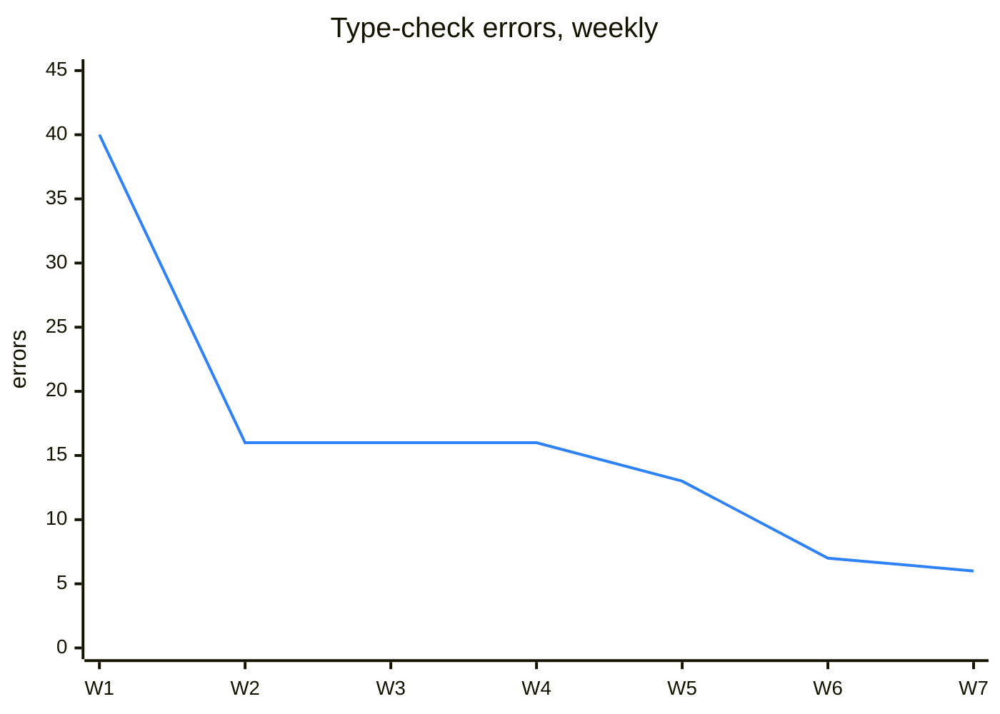
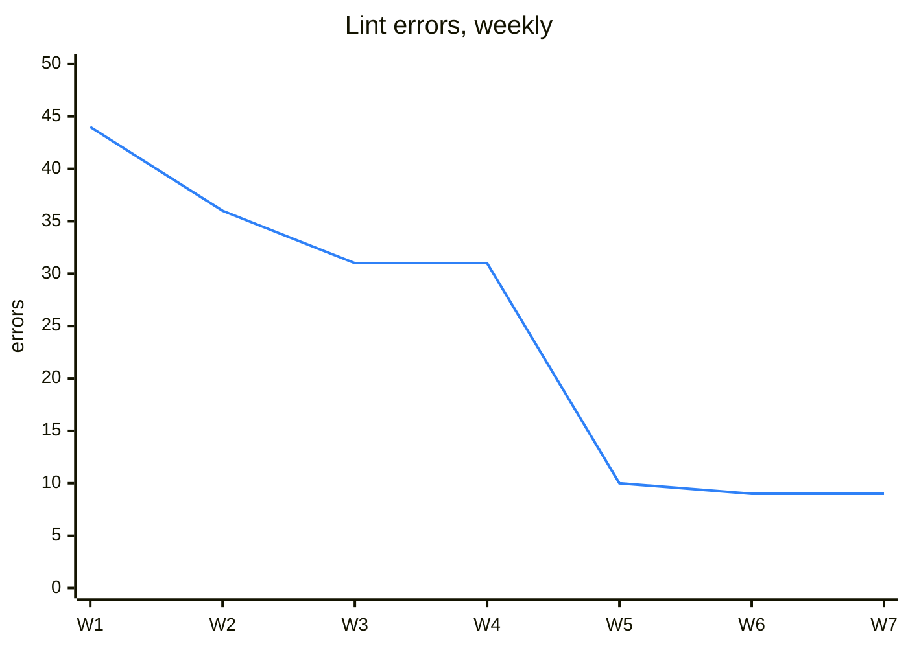
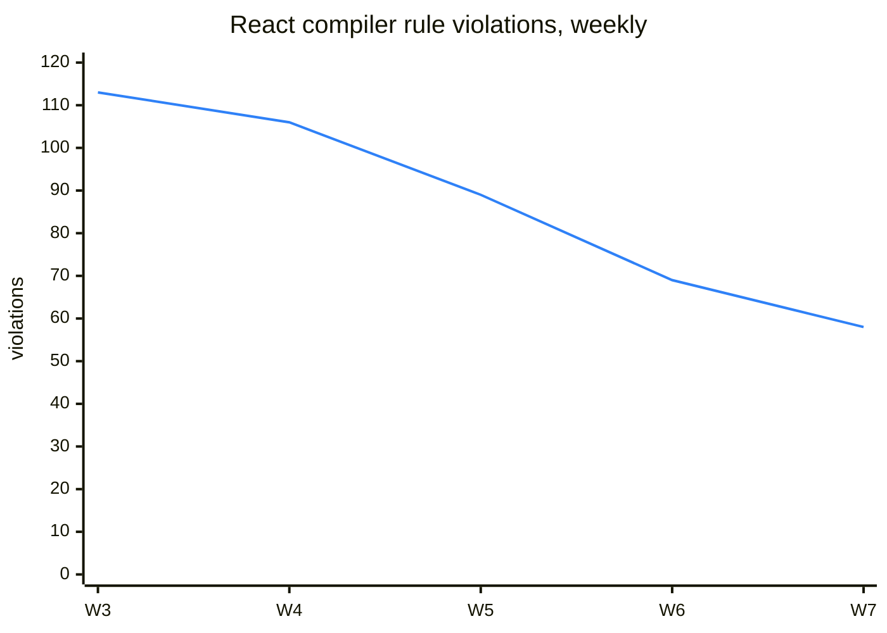

# Case study: the process before the tool

> **Disclaimer.** gauntlet did not produce these numbers. Before gauntlet existed as a tool, the process it packages was built by hand inside one large production monorepo. This page reports what happened there, taken from that project's git history and local gate log. The project is not named. Its numbers are reproducible from its history, and the method is described below.

## The project

- A product monorepo with an offline-first mobile app, a Postgres backend with edge functions, and shared TypeScript packages.
- Roughly 580 merged PRs between August and mid-October 2026, largely written by AI coding agents working from briefs and reviewed by agents and one human owner.
- An engineering-standards document, ADRs and an agent-instructions file. All of them were read by every agent, and all of them were violated anyway.

## What went wrong before

A PR passed review, lint, type-check and 1,105 tests, and still shipped two defects that reproduced a production outage. The standards document named four of the rules that PR broke. None of those rules had a detector. A rule nobody counted was a preference.

The response, starting 2026-09-06, was a set of **ratchets**. Each one counted a rule's violations across the repo, locked the count in a baseline file, and failed when the count rose. The gate moved from CI to a local pre-push hook the next day. Over the following weeks the project added:

- a **diff gate**: zero violations on added lines;
- a **touched-file gate**: a changed file must come out with a strictly lower count;
- an **escape hatch**: a commit trailer naming a path and a reason.

## Results

Each ratchet was measured from its first locked value to 2026-10-16.

| Debt | First | Latest | Change | Locked since |
|---|---:|---:|---:|---|
| Type-check errors (mobile) | 40 | 6 | −85.0 % | 09-06 |
| Duplicate definitions | 369 | 68 | −81.6 % | 09-06 |
| Lint errors (mobile) | 44 | 9 | −79.5 % | 09-06 |
| String literals compared instead of enums ¹ | 870 | 200 | −77.0 % | 09-13 |
| Silent `catch` blocks | 173 | 51 | −70.5 % | 09-24 |
| Exported functions without a return type ¹ | 265 | 91 | −65.7 % | 09-13 |
| `Record<string, T>` instead of declared fields | 499 | 131 | −73.7 % | 09-16 |
| Types exported beside behaviour | 606 | 194 | −68.0 % | 09-16 |
| React compiler rule violations | 113 | 58 | −48.7 % | 09-18 |
| Design-system misuse | 2,726 | 1,591 | −41.6 % | 10-04 |
| Mobile ↔ backend boundary violations | 35 | 22 | −37.1 % | 09-12 |
| Files left in legacy folders | 279 | 217 | −22.2 % | 09-24 |

¹ These are measured after the project deleted an entire web app (2026-09-13). Counting from the first lock would overstate them: −88 % and −82 %, partly through deletion rather than repair.

### Shipping did not slow down

The ratchets landed in week 36, and merged PRs per week rose after that:

| ISO week | 33 | 34 | 35 | 36 | 37 | 38 | 39 | 40 | 41 | 42 |
|---|---|---|---|---|---|---|---|---|---|---|
| merged PRs | 15 | 0 | 6 | 42 | 95 | 40 | 43 | 68 | 83 | 155 |

Many things changed in those weeks, so this does not prove the ratchets made the team faster. It does show they did not make it slower.

### The local gate caught real pushes

The gate's timing log starts on 2026-10-15. In its first week:
- **519** local pre-push runs; **71 blocked** (13.7 %) before reaching the remote;
- median run time 197 s, p90 691 s;
- a blocked run stopped early, at a median of 20 s.

The steps that blocked most were unit tests (8), an architecture-state check (8), the changeset check (5) and the touched-file gate (5).

## Where the hand-built version leaked

These leaks are why gauntlet's design looks the way it does.

### 1. The count went up 13 times

Every rise in every baseline was inspected, commit by commit:

| Kind | Cases | What it was | gauntlet's answer |
|---|---:|---|---|
| New rule or wider measurement | 7 | A new rule or a newly counted folder entered with its existing debt. Not new debt, but indistinguishable from it in a single total. | A new rule gets its own baseline entries. It is never mixed into an existing rule's total. |
| Tool bug | 1 | The diff gate overwrote the repo-wide lock with the diff's own count. Main was already 7 above the lock and nobody saw it. | The baseline is derived: only the runner writes it, and CI requires it to equal what the code measures. |
| New debt with a reason | 2 | +1 colour literal each, one explained in the commit ("a shared constant used by nine tokens, raised on purpose"). | Fails the gate whatever rows exist: a `loosen` row covers a rule that is loosened (for example `block` → `shadow`), not a violation added. Shipping the +1 on purpose means loosening the rule, with a row that states the reason. |
| New debt without a reason | 3 | +7 duplicate definitions in the first week ("raise baseline to 120"), before the diff gate covered that ratchet. | Fails the gate: the total of a `block` rule cannot rise. |

### 2. The escape hatch became routine

The trailer exception appeared in **38 commits** (136 waiver lines), between 7 % and 17 % of a week's commits. The agents could write it themselves, so they did. In gauntlet, exceptions live in `.gauntlet/exceptions.tsv`, written by command and not inside commit messages, and a path waiver applies only on its own branch. The gate fails a loosening without a row, and the rows show in the diff.

### 3. Lowered baselines depended on memory

When debt fell, the script rewrote the baseline, and an agent had to remember to commit it. A gate step existed only to catch the cases where nobody remembered, and it failed twice in the logged week. gauntlet writes the lowered baseline into the same commit that paid the debt.

### 4. A pattern, not a system

The project grew from 16 to 41 bespoke check and ratchet scripts. Each had its own baseline format and its own detector style, most of them regex over TypeScript text, and there was no guide for adding a rule. Linter-backed ratchets ran ESLint three times per push (≈140 s). gauntlet has:
- a single runner;
- one rule file format;
- declarative detectors only;
- a shared linter run for every rule that needs it, planned (IS-03).

### 5. Line numbers lie

The diff gate judged "new" by added lines. Reformatting a file made old violations look new. gauntlet identifies a violation by its fingerprint (rule + file + normalized line text) and never by its line number.

## Method

- **Baselines:** for every commit that touched a baseline file, the file was read at that commit. The total is its `total` field, or the sum of its per-rule counts, with date fields excluded.
- **Weekly points:** the last value in each ISO week. W1 is ISO week 36 of 2026.
- **Gate:** the JSON-lines timing log the pre-push hook writes into the git common directory.
- **Waivers and PRs:** read from commit messages on the main branch since 2026-08-01, with PRs taken from `(#NNN)` subjects.
- **Known noise:**
  - Some drops came from deleting code, not fixing it: a web app (−1,168), plus two later cleanups (−265, −124). Where that distorts a row, the table starts after the deletion, as footnote ¹ marks.
  - Gate data covers one week only.
  - Before the squash-merge policy (W38), commit counts include branch commits, which is why PRs per week is the throughput measure.
